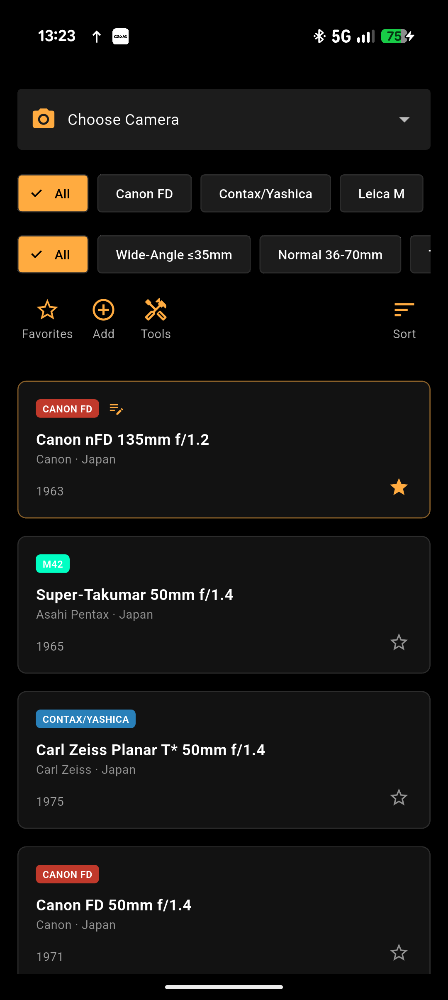
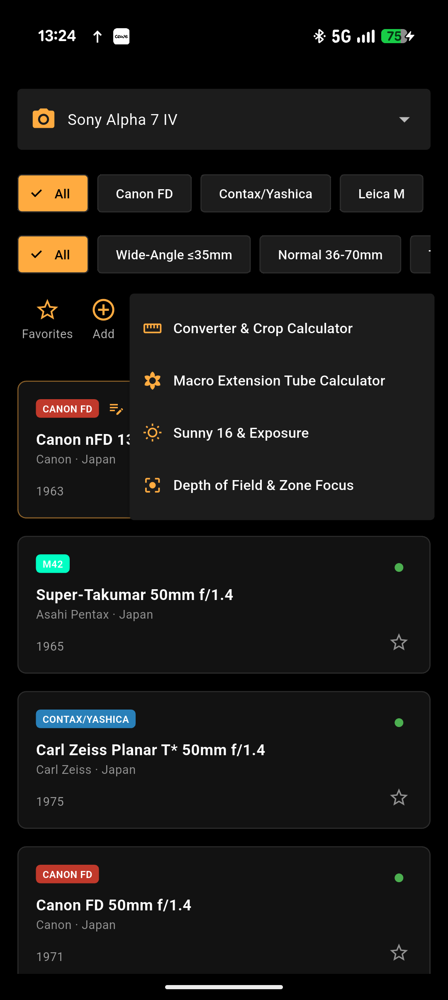
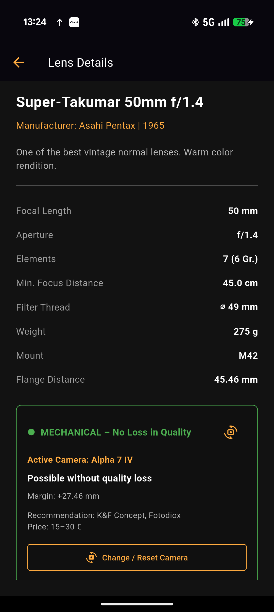

# altglas 📷

An Android app for vintage lens enthusiasts and manual photography fans. Currently in its early testing phase.

*Eine Android-App für Fans von Vintage-Objektiven und manueller Fotografie. Aktuell in der ersten Testphase.*

---

## 🇩🇪 Deutsch

**altglas** ist meine allererste eigene App und befindet sich aktuell mitten in der Testphase. Ziel des Projekts ist es, ein praktisches und schlankes Werkzeug für alle zu schaffen, die klassische manuelle Objektive an modernen Digitalkameras nutzen.

> **Hinweis:** Die App steht derzeit ausschließlich für Android zur Verfügung.

### Funktionen im Überblick
* **Objektiv-Datenbank:** Wichtige technische Daten wie Auflagemaß, Baujahr, Filtergewinde und optischer Aufbau auf einen Blick.
* **Adapter- & Kompatibilitäts-Check:** Sofortige Prüfung, ob und wie gut ein Objektiv-Mount an deine Kamera passt (inkl. Auflagemaß-Differenz).
* **Intelligentes Ampelsystem:** Sobald du eine moderne Kamera auswählst, zeigt dir die App direkt in der Objektiv-Ansicht per Ampelsystem an, wie gut das Objektiv adaptierbar ist:
  * 🟢 **Mechanisch (Grün):** Perfekte Adaptierung ohne optischen Qualitätsverlust (ausreichend Auflagemaß-Differenz).
  * 🟠 **Optisch (Orange):** Minimaler Qualitätsverlust, meist durch notwendige Ausgleichslinsen (Kompensation des Abstands).
  * 🔴 **Nicht empfohlen (Rot):** Das Auflagemaß ist kürzer als das der Kamera, eine scharfe Fokussierung auf unendlich ist ohne optische Korrektur nicht möglich.
* **Foto-Tools:** Integrierte Rechner für Schärfentiefe & Zone Focus, Makro-Zwischenringe, Telekonverter & Crop-Faktor sowie Sunny 16 & Belichtungshilfe.
* **Eigene Sammlung:** Favoriten speichern sowie benutzerdefinierte Objektive zur Datenbank hinzufügen, bearbeiten oder löschen.
* **Mehrsprachig:** Vollständig auf Deutsch und Englisch verfügbar.

### Ausblick & Geplante Features
Ich bin sehr offen für Community-Feedback und neue Ideen! In der Überlegung sind aktuell:
* **Blueprints:** Optische Linsenschnitte/Skizzen für die Objektive (aufwendig in der Umsetzung, aber denkbar).
* **Bild-Upload:** Option, eigene Fotos zu manuell hinzugefügten Objektiven hochzuladen.

---

## 🇬🇧 English

**altglas** is my very first app and has just entered its initial testing phase. The goal of this project is to build a practical companion for anyone shooting with classic manual glass on modern mirrorless or DSLR bodies.

> **Note:** The app is currently available exclusively for Android.

### Features
* **Lens Database:** Quick access to technical specifications including flange focal distance, production year, filter thread, and optical design.
* **Adapter Compatibility Check:** Instant verification whether a lens mount fits your camera body, including calculated flange differences.
* **Smart Traffic Light System:** Once you select a modern camera body, the app instantly indicates compatibility using a color-coded system:
  * 🟢 **Mechanical (Green):** Flawless adaptation without any optical degradation.
  * 🟠 **Optical (Orange):** Minimal quality loss due to necessary correcting elements.
  * 🔴 **Not Recommended (Red):** The lens flange distance is shorter than the camera's, making infinity focus impossible without corrective optics.
* **Photography Calculators:** Built-in tools for Depth of Field & Zone Focus, Macro Extension Tubes, Teleconverters & Crop Factor, and Sunny 16 Exposure Guide.
* **Personal Gear:** Save favorites and create, edit, or delete custom lens entries.
* **Multilingual:** Fully localized in English and German.

### Roadmap & Future Ideas
I am very open to new ideas and feature suggestions! Potential future additions:
* **Optical Blueprints:** Diagrams showing the internal element layout of lenses.
* **Photo Upload:** Option to attach custom photos to user-added lenses.

---

## 📱 App Impressions / App-Eindrücke

   &nbsp;&nbsp;&nbsp;
   &nbsp;&nbsp;&nbsp;
  

---

## 📥 Download & Testing / Download & Testen

You can download the latest Android build (`.apk`) from the **[Releases](../../releases)** section.

*Du kannst die aktuelle Android-Version (`.apk`) direkt unter **[Releases](../../releases)** herunterladen und auf deinem Smartphone installieren.*

---

## 💬 Feedback & Issues

Do you find a tool like this useful? Do you have suggestions or found a bug? 
Feel free to open an **[Issue](../../issues)** or share your thoughts!
